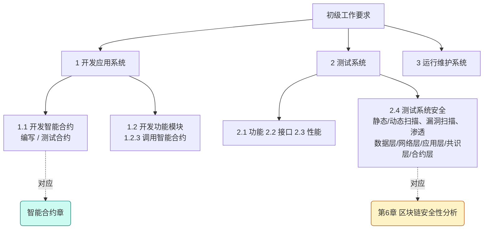
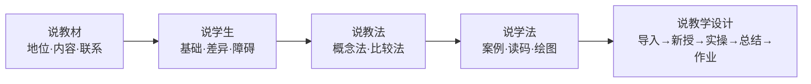
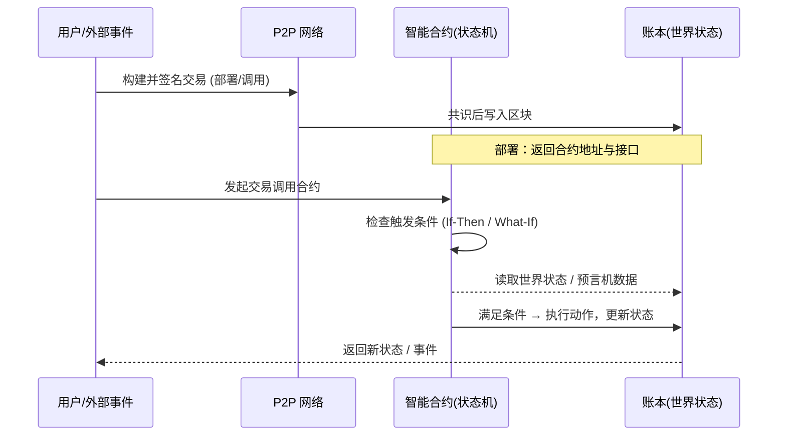
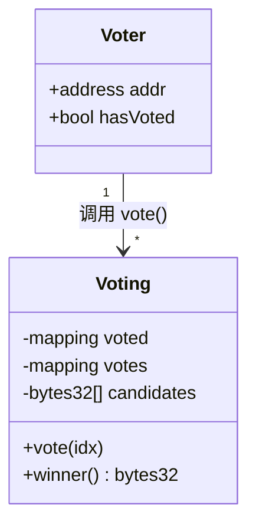
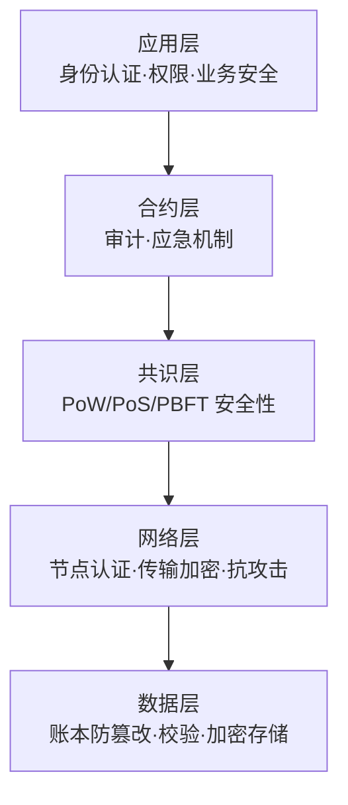
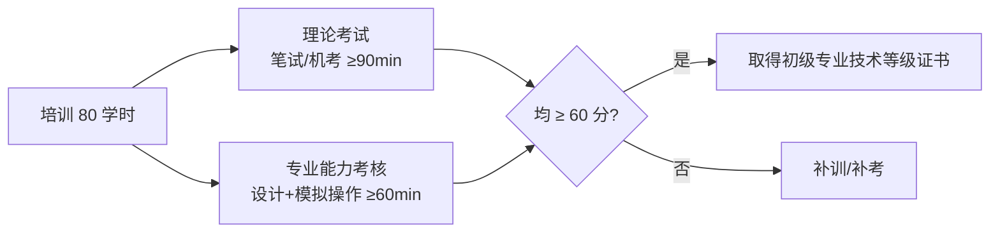

# 区块链技术基础知识（初级）
## 教师授课指南：智能合约 与 安全性

<div class="mt-8 text-lg opacity-80">
如何授课 · 如何备课 · 考试如何考 · 考试内容
</div>

<div class="mt-12 small opacity-70">
依据《区块链工程技术人员国家职业技术技能标准（2021年版）》，职业编码 2-02-10-15<br/>
时长 30 分钟 · 面向初级培训教师
</div>

<!--
【0.5 min】开场：本讲不是讲区块链，而是讲"怎么教"。
两条主线：智能合约和安全性分析（第6章）。最后落到"怎么考"。
-->

---

# 30 分钟议程

| 时段 | 内容 | 产出 |
|---|---|---|
| 0–5 min | 标准要求：学时、考核方式、权重 | 明确"教到什么程度" |
| 5–14 min | 智能合约：教学难点、实操设计 | 难点—对策表 + 实验流程 |
| 14–22 min | 安全性分析：教学难点、实操设计 | 五层安全模型 + 评估表/用例 |
| 22–28 min | 考试如何考：题型、命题示例、实操评分 | 命题蓝图 |
| 28–30 min | 小结与备课清单 | 行动清单 |


<!--
【0.5 min】过一下议程。强调每部分都按"理论难点 → 实操设计"组织。
-->

---

# 一、标准对初级培训与考核的要求

<div class="grid grid-cols-2 gap-6">
<div>

**培训要求（标准 1.8）**

| 项目 | 初级要求 |
|---|---|
| 培训学时 | **80 标准学时** |
| 培训教师 | 区块链工程技术人员**中级及以上**等级，或相关专业中级及以上职称 |
| 场所设备 | 标准教室或线上平台；计算机、网络、软件及硬件 |
| 学历基础 | 大学专科（或高职毕业） |

</div>
<div>

**考核要求（标准 1.9）**

| 项目 | 要求 |
|---|---|
| 维度 | 理论知识 + 专业能力，**各为百分制** |
| 合格线 | **均须 ≥ 60 分** |
| 理论 | 笔试 / 机考，**≥ 90 min** |
| 专业能力 | 专业设计、模拟操作等实验考核，**≥ 60 min** |
| 配比 | 理论监考 ≥1:15 且每场 ≥2 人；能力考评 ≥1:10，考评员 3 人及以上单数 |

</div>
</div>

<div class="tip">教学含义：理论与实操<b>两项都要过线</b>，实操不能只当"演示"，必须让学员动手。</div>

<!--
【1 min】来源：标准 1.8、1.9。注意"各项考核均实行百分制，成绩皆达60分（含）以上者为合格"。
-->

---

# 权重决定教学精力分配（初级）

<div class="grid grid-cols-2 gap-8">
<div>

**理论知识权重（%）**

<div class="bar-row"><div class="label">运行维护系统</div><div class="bar" style="width:70%;background:#6b7280">35</div></div>
<div class="bar-row"><div class="label">基础知识</div><div class="bar" style="width:40%;background:#0f766e">20</div></div>
<div class="bar-row"><div class="label">开发应用系统</div><div class="bar" style="width:40%;background:#0369a1">20</div></div>
<div class="bar-row"><div class="label">测试系统</div><div class="bar" style="width:40%;background:#b45309">20</div></div>
<div class="bar-row"><div class="label">职业道德</div><div class="bar" style="width:10%;background:#9ca3af">5</div></div>

</div>
<div>

**专业能力权重（%）**

<div class="bar-row"><div class="label">运行维护系统</div><div class="bar" style="width:80%;background:#6b7280">40</div></div>
<div class="bar-row"><div class="label">开发应用系统</div><div class="bar" style="width:60%;background:#0369a1">30</div></div>
<div class="bar-row"><div class="label">测试系统</div><div class="bar" style="width:60%;background:#b45309">30</div></div>

</div>
</div>

| 本讲内容 | 对应标准位置 | 说明 |
|---|---|---|
| 智能合约 | 基础知识 2.2.2(6)；开发应用系统 1.1、1.2.3 | 理论 + 能力均涉及，开发类共 20% / 30% |
| 安全性分析 | 基础知识 2.2.1(7)；测试系统 **2.4 测试系统安全** | 测试类共 20% / 30%，其中安全测试是重点 |

<!--
【1.5 min】图中数值来自标准第4部分权重表。注意：智能合约与安全性合计覆盖开发+测试两个"20%/30%"模块，是初级的重头戏。
-->

---

# 知识地图：两章在标准中的位置



<div class="tip">两章衔接点：<b>合约层安全</b>（审计、应急机制）——先会写合约，再会测合约。</div>

<!--
【1 min】用这张图建立"开发→测试"的教学链条。
-->

---

# 备课框架：「五说」+ 面向工程技术人员



| 环节 | 智能合约 | 安全性分析 |
|---|---|---|
| 说教材 | 区块链 2.0 核心；基础知识 **4 学时**；实现类似"虚拟硬件开发"，要求代码简单、一致、可审核 | 保障大规模应用的关键；承接合约开发，对应测试系统安全 |
| 说学生 | 具备面向对象基础者更易学；对算法与语言有畏难心理 | 缺乏攻防直觉；易把"安全"当成"加密" |
| 说教法 | 概念法（演绎/类比/归纳）、传统合约 vs 智能合约、以太坊 vs 超级账本 | 分层归纳法 + 工具演示 + 案例复盘 |
| 说学法 | Remix 案例学习；读合约代码；绘制类图 | 设计评估表/用例；Kali 工具试用 |

<!--
【1 min】"说教材/学生/教法/学法/教学设计过程"来自智能合约教学幻灯片。安全性一列为本讲据教材内容所做的延伸建议。
-->

---

# 二、智能合约：教学目标与知识层级

| 层级 | 知识点 / 能力 | 对应标准 |
|---|---|---|
| **了解** | 智能合约发展历史；实现的基本步骤；与传统合约的区别 | 2.2.2(6) |
| **熟悉** | 概念、优点与问题、应用场景；抽象模型与通用架构；运作机理 | 2.2.2(6) |
| **熟悉** | 合约语言类型；编译与部署；典型平台的结构、运行机制、部署与调用流程 | 1.1.1 相关知识 |
| **能做** | 使用语言和开发环境**开发**智能合约 | 1.1.1 |
| **能做** | 使用开发环境**测试**智能合约 | 1.1.2 |
| **能做** | 使用代码**调用**智能合约实现模块功能 | 1.2.3 |

<div class="tip">教学主线：<b>"概念 → 模型 → 语言/平台 → 开发流程 → 良好实践"</b>，最终落到 能开发、能测试、能调用。</div>

<!--
【1 min】层级词（了解/熟悉）取自教学幻灯片"知识和能力的总结"。能力三条取自标准初级1.1.1、1.1.2、1.2.3。
-->

---

# 智能合约：教学难点总览

| # | 难点 | 成因 | 建议对策 |
|---|---|---|---|
| 1 | 为什么"真正的智能合约"在区块链之后才出现 | 缺少"可信执行环境"概念 | 导入提问：传统合约靠谁执行？去信任如何实现？ |
| 2 | 抽象模型：**状态转换系统** | 抽象，无直观对象 | 用"账本 + 状态转换函数"画图推演一笔交易 |
| 3 | 运行原理：构建—部署—执行；事务与事件；预言机 | 概念多、流程长 | 时序图 + 总结流程，逐步对应到 Remix 操作 |
| 4 | 脚本型 / 图灵完备型 / 可验证型 语言区别 | 缺乏编程语言比较视角 | 三类语言对比表 + 代表平台 |
| 5 | 以太坊 vs 超级账本 的合约差异 | 平台细节多，易混淆 | 比较法：从语言、运行环境、部署调用、权限逐项对照 |
| 6 | 合约代码 ≠ 一般业务软件：简单、一致、可审核 | 学员惯于写复杂业务逻辑 | 与面向对象对比，用**类图**分析合约 |
| 7 | 不可篡改带来的"部署即上线" | 缺少安全与测试意识 | 前置到良好实践：测试、审计、应急 |

<!--
【1.5 min】只念难点 2、3、6，其余提示看表。难点 1 作为导入问题，原幻灯片即为导入设计。
-->

---

# 难点解析（一）：抽象模型与运行原理



<div class="small">

**板书口诀**：智能合约 = <b>事务处理和保存机制 + 完备的状态机</b>；事件/事务 A 进入，按触发条件产出事件/事务 B；合约扮演"裁判"，负责判断并执行。

</div>

<!--
【1.5 min】课堂活动：让学员用一笔"投票"交易走一遍这张图。预言机是易错点：合约自己拿不到链外数据。
-->

---

# 难点解析（二）：语言类型与平台比较

| 类型 | 特点 | 代表 |
|---|---|---|
| 脚本型 | 指令有限（< 200 条），无复杂循环/跳转，易写、功能有限 | 比特币 |
| 图灵完备型 | 可实现复杂业务逻辑 | 以太坊、超级账本 |
| 可验证合约型 | 非图灵完备，不支持循环与递归；可直接嵌入链上运行，无需先编译为虚拟机代码 | Kadena |

<div class="small">

**以太坊 vs 超级账本比较维度（建议教师补充课堂板书）**

| 维度 | 以太坊 | 超级账本 Fabric |
|---|---|---|
| 链类型 | 公有链（也可私有部署） | 联盟链 |
| 合约语言 | Solidity 等，运行在 EVM | Go / Java / Node.js 链码 |
| 运行环境 | EVM 虚拟机 | Docker 容器 |
| 执行模式 | 全网节点执行并共识 | 背书节点执行 → 排序 → 提交 |

</div>

<!--
【1 min】上表第一张来自教学幻灯片；第二张为课堂比较提纲，教学幻灯片第16页是平台比较图，请教师结合原图讲解，具体细节以教材为准。
-->

---

# 难点解析（三）：与面向对象对比，用类图分析合约

<div class="grid grid-cols-2 gap-6">
<div>



</div>
<div class="small">

| 对比 | 面向对象软件 | 智能合约 |
|---|---|---|
| 状态 | 内存/数据库 | **链上存储**，修改要付成本 |
| 业务 | 可复杂、可迭代 | 要**简单、一致、可审核** |
| 修改 | 随时发布新版本 | **部署后不可改**，需升级/迁移机制 |
| 异常 | 日志 + 修复 | 交易回滚；资金风险 |

</div>
</div>

<div class="tip">教学建议：<b>先画类图、再写合约</b>。已有 Java/Python 面向对象基础者用"类 → 合约、属性 → 状态变量、方法 → 交易函数"映射，降低畏难情绪。</div>

<!--
【1.5 min】对应教学幻灯片"用类图分析智能合约"。这是降低畏难心理的关键抓手。
-->

---

# 智能合约实操设计：从问题到部署测试


```solidity {all|4-9}
// 实验示例：简化投票合约（Remix 中即可编译、部署）
pragma solidity ^0.8.20;
contract Voting {
    mapping(address => bool) public voted;
    mapping(uint => uint) public votes;
    uint public candidateCount;
    constructor(uint n) { candidateCount = n; }
    function vote(uint idx) external {
        require(!voted[msg.sender], "already voted");
        require(idx < candidateCount, "bad index");
        voted[msg.sender] = true; votes[idx] += 1;
    }
}
```

<div class="small">

**课堂检查点**：① 同一账户投两次会怎样？② 越界下标会怎样？——引出 `require` 与交易回滚。后续实验：**投票、拍卖**。

</div>

<!--
【2 min】实操组织：2人一组，Remix 在线 IDE；建议先预习语言基础（学法中的"提前做好相关语言学习"）。
-->

---

# 智能合约实操：良好实践清单与评分点

| 良好实践 | 教学落点（学员做什么） | 实操检查 |
|---|---|---|
| 使用静态工具 | 对投票合约运行静态分析 | 能读懂告警 |
| 了解安全漏洞 | 识别 require 缺失、权限缺失 | 能指出风险点 |
| 编写单元测试 | 为 `vote()` 写正常/异常用例 | 用例 ≥ 3 条 |
| 衡量测试覆盖率 | 查看覆盖率报告 | 能解释未覆盖分支 |
| 配置持续集成 | 了解（初级只需知道概念） | — |
| 安全审计合约 | 与安全性章节衔接 | 知道上线前必须审计 |
| 安全存储密钥 | 不把私钥写进代码/仓库 | 能指出错误做法 |

<div class="warn">适用/不适用场景也要让学员判断：需要<b>多方互信、规则透明、自动执行</b>的场景适合；需要<b>频繁改规则、大量链下数据、强隐私</b>的场景要谨慎。</div>

<!--
【1 min 内合并进上页讲完】前六项来自教学幻灯片"能力实践部分"。最后的适用/不适用提示按教学幻灯片"适用与不适用场景"展开，课堂可让学员举例。
-->

---

# 三、安全性分析：章节结构与难点总览


| 难点 | 成因 | 建议对策 |
|---|---|---|
| CIA 三要素如何落到区块链 | 把"安全"简单等同于"加密" | 用对照表逐一映射到链上机制 |
| 为何单节点安全不等于系统安全 | 多方共治，节点分属不同实体 | 举例：共识节点被攻破的后果 |
| 五层各自的安全要求 | 层次多、条目细 | 一张分层图 + 一张"层—风险—措施"表 |
| 四种测试方法的区别与适用 | 术语相近 | 以"是否运行代码 / 是否模拟攻击"二维区分 |
| 评估表与用例的设计 | 缺少测试工程习惯 | 给模板，学员改写，不从零写 |

<!--
【1.5 min】章节结构取自第六章：4 节。重点强调"单节点安全难以保证系统整体安全"（教材原话意思）。
-->

---

# 难点解析（一）：CIA 三要素 → 区块链映射

| 要素 | 含义 | 区块链中的体现 | 常见误区 |
|---|---|---|---|
| **机密性** | 信息不被未授权者获取 | 密码算法、访问控制、隐私保护；账户地址为"半匿名" | 误以为链上数据天然保密——账本通常对参与方可见 |
| **完整性** | 信息不被未授权篡改 | 哈希嵌套的链式账本、数字签名、共识 | 误以为"不可篡改"绝对——51% 或节点被攻破风险 |
| **可用性** | 需要时可访问 | 多节点冗余、共识容错 | 误以为去中心化就一定高可用——网络分区、"脑裂" |

<div class="tip">课堂追问（取自思考题）：<b>为什么比特币账户地址是"半匿名"？</b>——引导学员从交易公开、地址关联分析讨论机密性边界。</div>

<!--
【1 min】三要素定义取自第六章第一节。右侧"体现"和"误区"为本讲的教学归纳。
-->

---

# 难点解析（二）：五层安全要求

<div class="grid grid-cols-2 gap-4">
<div>



</div>
<div class="small">

| 层 | 关注点（示例） |
|---|---|
| 数据层 | 哈希嵌套、数据校验、敏感信息加密存储、CA 私钥私密管理 |
| 网络层 | 节点身份、通信加密、DDoS/Eclipse 类攻击 |
| 共识层 | 恶意节点容错、"脑裂问题" |
| 合约层 | 部署前审计、暂停/恢复/升级 |
| 应用层 | Web 应用安全（OWASP 十大风险） |

</div>
</div>

<div class="small">教材案例已给出<b>数据层</b>（表6-1）和<b>合约层</b>（表6-2、6-3）；其余层由学员在实训中自行设计，正好训练"选一层设计评估表"。</div>

<!--
【1.5 min】层次模型取自教材"数据层、网络层、共识层、合约层和应用层"。右表网络层/共识层/应用层细项为教学归纳，具体以教材正文为准。
-->

---

# 难点解析（三）：四种安全测试方法

| 方法 | 是否运行代码 | 对象 | 特点 | 典型工具 |
|---|---|---|---|---|
| 静态安全扫描 | 否 | 源代码 | 无需编译与运行环境；词法/语法/控制流/数据流分析；成本低 | Slither 等（合约） |
| 动态安全扫描 | 是 | 运行中的应用 | 模拟请求发现运行期缺陷 | OWASP ZAP |
| 系统漏洞扫描 | — | 主机/网络/服务 | 发现已知漏洞与配置缺陷 | nmap、Nikto |
| 渗透测试 | 是 | 整个系统 | 模拟黑客综合利用漏洞 | Kali Linux 工具集 |

<div class="tip">口诀：<b>静态看代码，动态看运行，漏扫找已知，渗透做验证</b>。Kali 预装 300+ 安全工具（nmap、Wireshark、John the Ripper、OWASP ZAP、Nikto、Aircrack-ng 等）。</div>

<!--
【1 min】定义取自第六章第三节。工具列表中 Kali 工具见教材；Slither 为本讲推荐的合约静态分析工具，不属于教材原文。
-->

---

# 安全性实操设计（一）：评估表 + 测试用例

<div class="small">

**示例 A：数据层评估表（教材表6-1，节选）**

| 序号 | 安全要求 | 评估方法 | 结果判定 |
|---|---|---|---|
| 1 | 账本结构应具有防篡改性 | 测试系统 | 链式/近似链式存储，哈希嵌套 |
| 2 | 账本应具有数据校验功能 | 测试系统 | 能通过历史账本快速检验出被篡改记录 |
| 4 | 应加密存储敏感信息并设置访问权限控制 | 查阅材料 + 测试系统 | 敏感信息加密存储且有访问权限控制 |

**示例 B：合约应急机制测试用例（教材表6-3，节选）**

| 项 | 内容 |
|---|---|
| 测试目的 | 引入合约暂停、恢复、升级，将问题合约用户迁移到已修复的新合约 |
| 步骤 | ①暂停并调用 ②恢复并调用 ③升级并调用 |
| 预期 | ①失败 ②成功 ③自动执行新合约且可访问旧合约历史数据 |

</div>

<div class="tip">教学方法：给<b>空白模板</b>，让学员选一层补全 3 条要求；训练"要求 → 方法 → 判定"的测试思维。</div>

<!--
【1.5 min】表格内容摘自教材表6-1、6-3，做了节选。强调评估方法有两种：查阅材料 vs 测试系统。
-->

---

# 安全性实操设计（二）：合约层漏洞演示

<div class="grid grid-cols-2 gap-4">
<div>

**有缺陷的提现（先转账后改状态）**

```solidity
function withdraw() external {
    uint amt = balances[msg.sender];
    (bool ok,) = msg.sender.call{value: amt}("");
    require(ok);
    balances[msg.sender] = 0;   // 太晚了
}
```

</div>
<div>

**修复：检查—生效—交互**

```solidity
function withdraw() external {
    uint amt = balances[msg.sender];
    balances[msg.sender] = 0;   // 先改状态
    (bool ok,) = msg.sender.call{value: amt}("");
    require(ok);
}
```

</div>
</div>

| 实训步骤 | 说明 |
|---|---|
| ① 静态扫描 | 对左侧代码运行静态分析工具，观察是否提示重入风险 |
| ② 编写测试 | 用攻击合约重复回调，验证余额被多次提取 |
| ③ 修复回归 | 应用右侧写法，测试通过，并把过程填入测试用例表 |

<div class="warn">仅限在本地/测试环境实施；强调职业守则"遵守法律，保守秘密"。</div>

<!--
【1.5 min】重入是合约层经典问题，用于衔接"开发—测试"。注意：示例代码用于教学演示，需教师在 Remix 本地环境事先验证。
-->

---

# 四、考试如何考：理论 + 专业能力



| 本讲内容 | 理论考什么 | 能力考什么 |
|---|---|---|
| 智能合约 | 概念、模型、语言类型、平台对比、流程 | 编写 / 测试 / 调用一个简单合约 |
| 安全性 | CIA、五层要求、四种测试方法 | 设计评估表或测试用例；使用工具扫描 |

**命题蓝图建议（教师自行把握，非标准强制）**：理论卷 100 分，智能合约约 **14 分**（基础知识中约 4 + 开发中约 10），安全性约 **10 分**（测试系统中安全部分）；实操以"合约开发测试 + 安全测试"为主线。

<!--
【1.5 min】流程与合格线来自标准 1.9。分值是估算建议：基础知识20、开发20、测试20，按两章在其中占比估计。
-->

---

# 理论命题示例（含答案要点）

| 题型 | 示例题 | 答案要点 |
|---|---|---|
| 单选 | 下列哪类合约语言**不支持循环与递归**，且可直接嵌入链上运行？ | 可验证合约型（如 Kadena） |
| 判断 | 智能合约一经部署即可随时直接修改源代码。（ ） | ✗ 部署后不可篡改，需升级/迁移机制 |
| 单选 | 信息安全三要素不包括？ | 可追溯性（三要素：机密性/完整性/可用性） |
| 多选 | 属于区块链五层安全中"合约层"要求的是 | 部署前审计、暂停/恢复/升级 |
| 配对 | 静态扫描 / 动态扫描 / 漏洞扫描 / 渗透测试 ↔ 特点 | 看代码 / 看运行 / 找已知 / 模拟攻击 |
| 简答 | 简述智能合约"构建—部署—执行"过程 | 多方制定→交易部署返回地址→满足触发条件自动执行并更新状态 |
| 简答 | 为什么仅保障单个节点安全不足以保证系统安全？ | 安全由共识节点共同维护；多利益实体管理不一 |
| 论述 | 对比以太坊与超级账本合约的部署与调用差异 | 语言、运行环境、权限与执行流程 |

<div class="tip">命题原则：<b>了解/熟悉层级以选择、判断、简答为主；"能做"层级交给专业能力考核。</b></div>

<!--
【2 min】选 3 题现场讲：判断题"部署即不可改"、简答"单节点"、配对"四种方法"。以上均为本讲原创示例，教师可据此扩题。
-->

---

# 专业能力考核示例与评分点

| 考核项 | 任务（≥60 min 内完成） | 评分点 | 分值 |
|---|---|---|---|
| 合约开发 | 在 Remix 完成投票/拍卖合约，编译并部署 | 能编译部署；逻辑正确 | 30 |
| 合约测试 | 至少 3 条用例，含异常用例 | 用例设计合理；结果记录 | 20 |
| 合约调用 | 用代码或界面调用合约函数 | 调用成功；理解返回值 | 10 |
| 安全评估 | 选择一层，设计 3 条评估要求 | 要求—方法—判定完整 | 20 |
| 安全扫描 | 用指定工具扫描并解读 ≥2 条告警 | 工具使用正确；解读合理 | 20 |

<div class="small">

**组织要点**：考评员 **3 人及以上单数**，考评员与考生配比 **≥ 1:10**；以"专业设计、模拟操作"为主，评分表逐项打分，留存测试记录。

</div>

<!--
【1 min】考核方式与配比取自标准；分值与任务为建议设计，教师可按学校实际调整。
-->

---

# 备课与教学常见问题（避坑）

| 问题 | 表现 | 建议 |
|---|---|---|
| 只讲概念不动手 | 实操成绩不过线 | 每个知识块配 1 个 Remix 小实验 |
| 平台细节陷入过深 | 超出初级"熟悉"要求 | 以比较表为纲，不展开源码 |
| 安全只讲"加密" | 答不出五层与测试方法 | 用分层图 + CIA 对照表兜底 |
| 工具堆砌 | 学员只会点按钮 | 每个工具只配一个明确任务 |
| 忽视合规 | 渗透测试越界 | 强调授权测试；遵守法律、保守秘密 |

**课后作业（建议）**

- 智能合约：思考题 + 绘制一份合约类图
- 安全性：教材思考题 1、3、6（半匿名、脑裂问题、PoW/PoS/PBFT 安全性）；实训：设计评估表 + 测试用例；安装 Kali 并介绍 3 个工具

<!--
【1 min】作业来自第六章实训与思考题。
-->

---

# 小结：备课清单

<div class="grid grid-cols-2 gap-6">
<div>

**授课**
- ✔ 先对标：**初级 80 学时；理论、能力均需 ≥60 分**
- ✔ 智能合约主线：概念→模型→语言/平台→流程→良好实践
- ✔ 安全性主线：CIA→五层→四种测试→评估表/用例
- ✔ 难点用**图、表、类图、对比**化解

</div>
<div>

**备课与考试**
- ✔ 五说：教材、学生、教法、学法、教学设计
- ✔ 每章配"理论难点 + 实操任务"
- ✔ 理论考"了解/熟悉"，能力考"能做"
- ✔ 评分表、测试记录、授权规范要备齐

</div>
</div>

<div class="tip mt-6">一句话：<b>合约要会写，更要会测；理论要讲清，实操要过线。</b></div>

<!--
【1 min】收尾。提醒两处提示：①教材第五章（智能合约）幻灯片中平台比较图请结合原图；②第六章教材节选内容较少，教师可对照教材完整文本补充。
-->

---
layout: center
class: text-center
---

# 谢谢

<div class="opacity-70">区块链工程技术人员（初级）教师授课指南</div>
